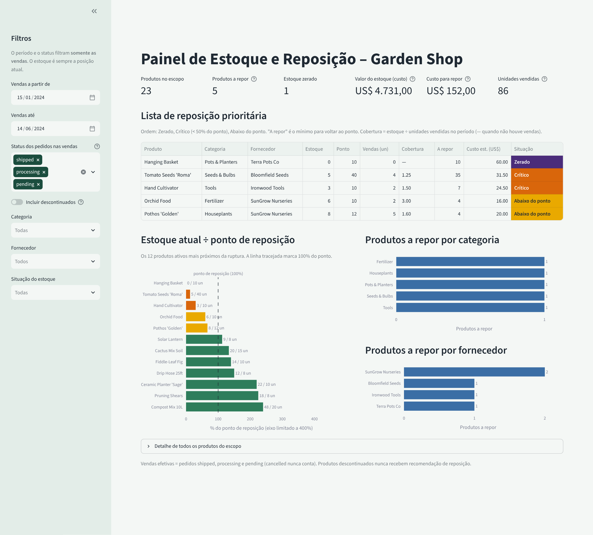

# Garden Shop – Dashboard de Estoque e Reposição

Painel interativo (Streamlit) que ajuda a equipe de uma loja virtual de jardinagem a decidir **o que repor primeiro, de qual fornecedor e quanto custa**, além de mostrar quanto capital está parado em estoque.



## O problema

A Garden Shop vende plantas, sementes, ferramentas, vasos, fertilizantes e itens de decoração. As informações sobre produtos, estoque, fornecedores e vendas ficam em tabelas separadas, e a gestão não consegue ver rapidamente quais produtos precisam de atenção. O painel junta esses dados e responde, em uma tela:

- Quais produtos estão abaixo do nível de reposição, zerados ou muito baixos?
- Em que ordem devo repor, e qual o custo mínimo para voltar ao nível recomendado?
- Quais categorias e fornecedores concentram os itens a repor?
- Quais produtos vendem mais e não podem faltar?
- Quanto vale o estoque, considerando o custo cadastrado?

## O que o painel mostra

**Indicadores:** produtos no escopo, produtos a repor, estoque zerado, valor do estoque (a custo), custo para repor e unidades vendidas.

**Visualizações:**
- Lista de reposição prioritária (Zerado, depois Crítico, depois Abaixo do ponto), com fornecedor, quantidade a repor e custo estimado.
- Gráfico de estoque atual ÷ ponto de reposição dos 12 produtos mais próximos da ruptura.
- Produtos a repor por categoria e por fornecedor.
- Tabela de detalhe de todos os produtos do escopo.

**Filtros:** período das vendas, status dos pedidos, categoria, fornecedor, situação do estoque e a chave "Incluir descontinuados".

## Regras de negócio principais

| Regra | Como o painel trata |
|---|---|
| Pedidos cancelados | `cancelled` nunca conta como venda. |
| Pedidos em andamento | `shipped`, `processing` e `pending` contam como venda efetiva (demanda já assumida). |
| Produtos descontinuados | Nunca recebem recomendação de reposição. Com a chave ligada, aparecem no escopo, no valor e nas vendas, mas não na reposição. |
| Estoque x período | O estoque é sempre a posição atual (`quantity_on_hand`). O período filtra só as vendas. |
| Situação do estoque | Zerado (0), Crítico (menos de 50% do ponto), Abaixo do ponto (menos de 100%) e Adequado. |
| Quantidade a repor | `reorder_level − quantity_on_hand`: é o mínimo para voltar ao ponto, não um lote de compra. |
| Valor do estoque | `quantity_on_hand × cost` (custo, não preço de venda). |
| Duplicação | As vendas são somadas por produto **antes** de ligar às demais tabelas, para não repetir o estoque de um produto que tem vários itens de pedido. |

## Como executar

Requisito: Python 3.13 (versão em que o projeto foi testado).

```bash
python -m venv .venv
source .venv/bin/activate            # Windows: .venv\Scripts\activate
pip install -r requirements.txt
streamlit run app.py                 # abre o painel no navegador
python -m pytest -q                  # roda os 68 testes
```

Para usar outra pasta de CSVs: `GARDEN_SHOP_DATA_DIR=/caminho/para/csvs streamlit run app.py`.

A lista de comandos verificados e ainda não verificados está em `AGENTS.md`.

## Estrutura do projeto

```
app.py                    Tela do painel (filtros, indicadores, gráficos, tabelas)
garden_shop/loader.py     Leitura, validação e limpeza dos CSVs
garden_shop/metrics.py    Regras de cálculo (funções puras)
tests/                    Testes automatizados e recorte pequeno dos CSVs (tests/fixtures)
data/raw/                 CSVs originais (somente leitura, nunca alterados)
docs/print_dashboard.png  Print do painel em execução
PRD.md · SPEC.md · AGENTS.md   Documentação do projeto
```

## Dados

Os dados são os arquivos do Garden Shop SQL Practice Dataset fornecidos na disciplina: `products`, `categories`, `suppliers`, `orders`, `order_items` e `customers`. O painel usa apenas as cinco primeiras tabelas e só os campos necessários (lista completa em `SPEC.md`). `customers` não é usada. Os arquivos em `data/raw/` ficam exatamente como foram recebidos.

## Documentação

| Arquivo | Conteúdo |
|---|---|
| [`PRD.md`](PRD.md) | Problema, usuário, objetivos, escopo, requisitos, regras de negócio e critérios de aceitação. |
| [`SPEC.md`](SPEC.md) | Entradas, fórmulas, filtros, tratamento de erros, prevenção de duplicação e exemplos com resultado esperado. |
| [`AGENTS.md`](AGENTS.md) | Como preparar o ambiente, executar, testar, organizar o código e revisar alterações. |

## Como foi construído

O projeto seguiu o processo da disciplina: entender o problema, fazer brainstorming com IA, escrever o PRD, validar os requisitos, produzir a SPEC e só então implementar e testar. Os testes das regras de cálculo foram escritos **antes** do código (no histórico, cada commit `test:` vem antes do commit `feat:`), e dois indicadores foram conferidos à mão em um recorte pequeno dos CSVs. A IA generativa (Claude) foi usada como par de trabalho, com revisão do conteúdo e das alterações. O desenvolvimento foi feito em branches pequenas, integradas na `main`.

## Limitações

- Não há histórico de movimentação de estoque nem prazo de entrega dos fornecedores. Por isso o painel mostra a situação atual e **não** faz previsão de demanda nem de ruptura.
- As vendas cobrem pouco tempo (15/01/2024 a 14/06/2024, 24 pedidos), com muitos empates entre produtos.
- Não se sabe se `quantity_on_hand` já desconta pedidos ainda não enviados.
- O dicionário de dados informa datas em `DD/MM/AAAA`, mas os CSVs usam `AAAA-MM-DD`. O carregador aceita os dois formatos.

## Autor

George Pagliuso
